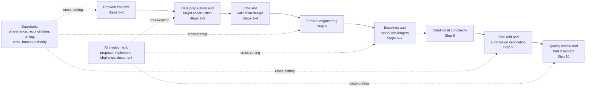

# IAA AI-Assisted Actuarial Hackathon 2026 — Part 1

This repository builds a controlled pricing workflow for private motor, home buildings and home contents. It predicts policy-period cost, not premium, claim probability alone or an annual rate left unscaled.

> [!IMPORTANT]
> **Current implementation step:** revised Step 10 — `executed with limitations`; mechanical quality and reproduction checks passed, but upload readiness is `blocked`.
>
> **Evidence-supported progress:** Steps 0–2 and 4–8 are `executed and passed` within their stated machine/proxy boundaries. Step 3 is `executed with limitations` because true ultimate is not identified. Step 9 is `executed and passed` mechanically and `human decision pending`. Step 10 is `executed with limitations` because critical rules, ultimate-target and human-review evidence remain unresolved.
>
> **Model trained:** yes — `S6_selected_compact_tweedie_glm` was fitted separately by line and refitted on the repaired 2021–2024 population.
>
> **Submission file generated:** yes — a local, mechanically verified 626,639-row candidate exists. It predicts a December 2024 observed-incurred snapshot proxy, not validated ultimate outcomes.
>
> **Kaggle status:** nothing has been uploaded; no final entry has been selected. Part 2 has not been executed.

A prompt file is an execution contract, not proof that a step ran. Completion claims above come from acceptance reports, manifests, tests and frozen artefacts. The current quality decision is [blocked](reports/step10/final-readiness.md), even though the file and package checks passed.

## What the project predicts

The intended quantity is the **expected ultimate net claim cost, in fictional currency units, for each 2025 policy-period row**. Losses are attached to coverage using the loss date and inclusive policy-period boundaries. “Ultimate” means the eventual cost after unreported losses, further development and recoveries are considered; it is an expectation across possible outcomes, not a guarantee for one policy. The target is a policy-period amount, so an annual loss rate must be multiplied by exposure exactly once.

The task is zero-heavy continuous regression. The published metric is **Tweedie D² with power 1.5**:

```text
D² = 1 - model deviance / null-model deviance
```

Higher is better. It rewards improvements in conditional-mean prediction and calibration relative to the metric's null prediction; it penalises poor cost predictions, including material underprediction of positive losses. It is not a pure ranking metric. The repository provisionally pools policy rows without score weights because the exact official row/line pooling and weighting implementation remains unresolved.

The supplied claims are valued at 31 December 2024. They do not provide later ultimate outcomes or historical financial vintages. The implemented response therefore remains explicitly named `repaired_observed_net_incurred_snapshot_2024-12-31`. It is useful for controlled comparisons, but it does not establish ultimate-loss accuracy.

## Canonical workflow

The revised prompt-algorithm numbering is the canonical execution order:

| Revised step | Purpose | Evidence status |
| ---: | --- | --- |
| 0 | Repository scaffold and operating controls | `executed and passed` |
| 1 | Prediction, scoring and submission contract | `executed and passed`; human actuarial acceptance pending |
| 2 | Clean, reversible data layer | `executed and passed`; repair-adoption decisions remain pending |
| 3 | Claim linkage, observed response and maturity bridge | `executed with limitations`; true ultimate is not identified |
| 4 | Chronological validation framework | `executed and passed` as a retrospective snapshot-proxy framework |
| 5 | Simple baselines and pipeline-check file | `executed and passed` |
| 6 | Feature blocks and measured ablations | `executed and passed` |
| 7 | LightGBM Tweedie challenger | `executed and passed`; challenger rejected on the primary comparison |
| 8 | Conditional additional complexity | `executed and passed`; benchmark retained |
| 9 | Final model refit and verified local candidate | `executed and passed` mechanically; `human decision pending` |
| 10 | Final quality gate, communication and Part 2 handoff | `executed with limitations`; upload readiness `blocked` |



The arrows show dependency order, not that every scientific question is resolved. EDA recurs as evidence develops; AI involvement and guardrails operate across the workflow rather than occupying one isolated modelling step.

### Numbering note

The clarification brief refers to an older 12-step planning sequence, while this checkout contains [a consolidated 10-section plan](docs/plan.md) and revised execution prompts numbered 0–10. Historical files are not renumbered or rewritten. The requested conceptual cross-reference is:

| Original 12-step plan | Revised implementation |
| ---: | ---: |
| 1 | 1 |
| 2–4 | 2–3 |
| 5 | 4 |
| 6 | 5 |
| 7 | 6 |
| 8 | 7 |
| 9–10 | 8 |
| 11 | 9 |
| 12 | 10 |

The original 12-step source document is not present in this checkout, so this table records the mapping supplied by the clarification brief rather than claiming a line-by-line verification. The earlier `PROMPT_ALGORITHM.md` also uses prompts 01–07 to implement canonical Step 1; those prompt numbers are substeps, not competing project phases.

## Workstreams

### A. Problem framing and scoring

The Step 1 contract fixes the prediction grain, units, loss-date allocation, exposure treatment, metric power and submission boundary before model comparison. One row represents one 2025 policy period. Expected ultimate net claim cost is distinct from the annual loss rate used internally by a rate model and from the observed-incurred proxy available for training.

Tweedie D², mean deviance, prediction totals and actual-to-expected ratios are reported together. D² can show comparative predictive fit without proving calibration, prospective availability or ultimate adequacy. Official pooling and weighting details remain unresolved and are not silently inferred from the standard library implementation.

### B. Data preparation

Data preparation determines what the records mean. The implemented layer preserves raw files and values, then creates reversible, versioned derivatives that:

- repair motor customer IDs with lost leading zeros;
- reconstruct exposure from inclusive dates under the documented ACT/365 convention;
- retain separately labelled home sum-insured unit candidates rather than overwriting source values;
- normalise identifiers and dates without changing policy-row grain;
- validate customer, address and address-year weather joins with controlled keys;
- link claims to the policy period covering the loss date;
- reconcile duplicates, recoveries, repudiations, unmatched claims and zero-claim policies; and
- keep observed responses, reporting diagnostics and assumption-dependent maturity scenarios distinct.

These operations are not feature engineering and are not changed merely to improve a validation score. Raw data remain read-only and row-level repaired outputs remain outside Git.

### C. Exploratory data analysis

EDA investigates what the data contain. Across Steps 2–10 it covers row counts, types, missingness, exposure and year distributions, zero-cost frequency, severity, open claims, reporting delay, recoveries, large losses, recurring versus new policies, suspicious associations, calibration, residuals and tail behaviour.

The evidence labels matter:

- an **observed association** describes the supplied snapshot;
- a **modelling hypothesis** proposes something to test;
- a **verified data error** has reproducible source evidence and a reversible repair;
- an **approved predictive feature** additionally passes timing, leakage, implementation and measured-comparison checks.

EDA alone does not prove causality, prospective availability, a unit error, an ultimate uplift or feature usefulness. For example, open-claim patterns reveal maturity risk but cannot identify monetary IBNR from one valuation snapshot.

### D. Feature engineering

Feature engineering creates predictors available by the fold's prediction date. Implemented and tested blocks include motor age/licensing and ordinary missingness effects; buildings and contents insured-value transformations; and auditable occupancy, household-use and security factors. Candidate domains also include vehicle characteristics, structural telematics missingness, prior reported history and weather/climatology only where prospective availability can be justified. Written premium remains a separately labelled tariff comparator rather than a hidden core feature.

The final model excludes current-period claim outcomes, final claim status, `renewal_decision`, service contacts with unknown timing, post-period information, response/target/provenance fields and raw identifiers as predictors. Imputation, encoding, scaling, cut points, history and weather construction must use only information allowed by the training side of each fold.

### E. Model building and model choice

Model building fits candidates in a controlled order:

1. global training-mean baseline;
2. line-specific annual loss cost multiplied by exposure;
3. premium comparator where its basis is established;
4. compact power-1.5 Tweedie GLMs;
5. bounded LightGBM Tweedie challengers; and
6. additional complexity only after a predeclared evidence gate.

Model choice compares candidates on identical held-out IDs, folds and response versions. It considers D² and deviance, calibration, line and segment results, tail behaviour, temporal stability, maturity sensitivity, runtime, interpretability, reproducibility and incremental complexity. The highest score on one reused challenge year is not automatically selected.

The selected S6 GLM achieved provisional pooled D² of **0.113452** on the primary F2023 comparison and **0.089801** on the reused F2024 challenge. The LightGBM challenger was worse on F2023 and better on F2024, with material stability/calibration concerns; it was not promoted. A later contents curvature test produced an immaterial, uncertain primary gain and was also rejected. These are retrospective snapshot-proxy results, not ultimate validation.

### F. AI involvement

AI is a cross-cutting collaborator, not a substitute for actuarial judgement. It has supported schema inspection, test and implementation drafts, inconsistency detection, feature/model proposals, experiment comparison and documentation. Evidence is recorded in this form:

```text
Task → AI proposal → verification → human decision/status → implementation → measured consequence
```

Humans remain responsible for data-correction adoption, the claim universe, maturity and recovery assumptions, prospective feature eligibility, model promotion, limitations and upload authorisation. Where no genuine human decision exists, the status remains `human decision pending`; automated checks are not relabelled as human oversight. See the [AI direction log](docs/part1/ai-direction-log.md).

### G. Guardrails and governance

Guardrails determine whether results are trustworthy. They include raw-data immutability, reversible correction ledgers, row/join/financial reconciliation, explicit response versions, no unsupported ultimate labels, chronological validation, train-only preprocessing, feature-timing checks, exposure applied exactly once, same-row model comparisons, bounded searches, saved hashes/configurations/environments, model reload and deterministic rerun tests, exact submission-ID/schema checks, and visible failure states.

The repository does not treat the presence of a card, a test suite or an AI review as professional approval. It does not claim official scorer equivalence, independent human sign-off or compliance with unchecked professional sources.

### H. Results, submission and handoff

Results accumulate progressively: preparation and reconciliation findings; maturity and scenario findings; baseline scores; feature ablations; GLM-versus-LightGBM comparisons; robustness and tail diagnostics; the final model decision; a verified 2025 local prediction file; and the Step 10 quality review and Part 2 plan.

The frozen local candidate has exactly `row_id,prediction`, 626,639 unique IDs in sample order, finite positive policy-period predictions and one exposure multiplication. Its SHA-256 is `dfb3e565d97f0a4a597ab3051b6cffd616da5022aaf8da10aa0736db436e6274`. The exact candidate remains ignored by Git because it is a row-level output. Kaggle upload, human approval and final-entry selection are separate actions and remain pending.

## Phase-to-workstream matrix

| Workstream | Primary purpose | Revised steps | Main outputs | Main guardrails |
| --- | --- | --- | --- | --- |
| Problem framing | Fix the prediction, metric and file contract | 0–1 | Source register, problem contract, scorer and submission validator | Source status, explicit unknowns, fixed power and units |
| Data preparation | Make records consistent and linkable without score-driven redefinition | 2–3 | Repaired layer, ledgers, claim crosswalk, observed response and maturity diagnostics | Raw immutability, reversible rules, row/money reconciliation |
| Exploratory analysis | Investigate quality, maturity, segments, calibration and tails | 2–10, recurring | Profiles, maturity analyses, residual/segment/tail diagnostics | Association is not causation, minimum credibility, no silent transformation |
| Feature engineering | Create prospectively eligible predictors | 4 and 6 | Availability registry, feature blocks and ablations | Cutoff-aware construction, train-only fitting, leakage-safe joins |
| Model building and choice | Fit references, test challengers and retain justified complexity | 5–9 | Baselines, GLMs, LightGBM comparison, complexity decision and frozen refit | Same rows/response, predeclared gates, exposure once, challenge discipline |
| AI involvement | Support analysis, implementation, challenge and communication | 0–10, cross-cutting | Prompt logs, direction log, code/tests/docs | Verify material claims; never invent human review or impact |
| Guardrails | Keep evidence traceable, comparable and reproducible | 0–10, cross-cutting | Configs, schemas, hashes, tests, manifests and failure states | Immutable inputs, provenance, exact alignment, deterministic checks |
| Results and handoff | Communicate achieved evidence and authority boundaries | 5–10 | Result reports, local candidate, quality matrix and Part 2 handoff | Honest limitations, controlled package, separate upload/final-selection decisions |

## Repository navigation

| Location | What to find there |
| --- | --- |
| [`context.md`](context.md), [`what-good-looks-like.md`](what-good-looks-like.md) | Original user context and quality bar; preserved historical briefs, not automatically current status |
| [`AGENTS.md`](AGENTS.md) | Current operating controls and active scope |
| [`prompts/`](prompts/) | Execution contracts; their presence does not establish completion |
| [`src/iaa_hackathon/`](src/iaa_hackathon/) | Implementation for preparation, targets, validation, models and file checks |
| [`configs/`](configs/) | Problem, cleaning, validation, feature, experiment and frozen-model contracts |
| [`tests/`](tests/) | Synthetic behavior, invariant, leakage, alignment and reload checks |
| [`reports/`](reports/), [`docs/`](docs/) | Reviewed aggregate evidence, decisions, acceptance and interpretation |
| `outputs/` | Generated row-level artefacts, fitted objects and local manifests; normally ignored by Git |
| `submissions/` | Verified local candidate files; ignored by Git and not evidence of Kaggle upload |
| [`requirements/`](requirements/), [`Makefile`](Makefile) | Tested environment pins and reproducibility commands |

## Reproduce and review

Use Python 3.12.11 and `requirements/step7-py312.lock`. Numerical reproduction also requires the authorised original data and ignored repaired/frozen artefacts; a Git clone alone is deliberately not a self-contained data/model bundle.

```sh
python3.12 -m venv .venv
.venv/bin/python -m pip install -r requirements/step7-py312.lock
.venv/bin/python -m pip install --no-build-isolation --no-deps .
make check PYTHON=.venv/bin/python
make step10-check PYTHON=.venv/bin/python
make verify-submission PYTHON=.venv/bin/python DATA_DIR='/path/to/official/public'
make reproduce-part1 PYTHON=.venv/bin/python DATA_DIR='/path/to/official/public'
make verify-part1-package step10-acceptance PYTHON=.venv/bin/python DATA_DIR='/path/to/official/public'
```

The latest recorded run passed 186 tests, verified the frozen candidate and reproduced the CSV/model/schema bytes exactly in the tested environment. These commands do not resolve scientific and authority blockers. Read the [executive summary](docs/part1/executive-summary.md), [results and diagnostics](docs/part1/results-and-diagnostics.md), [limitations](docs/part1/limitations-and-assumptions.md), [reproducibility handoff](docs/part1/reproducibility.md) and [final readiness report](reports/step10/final-readiness.md) before using the candidate.

## What remains unresolved

- Current official deadline, Part 1 deliverables/timing, submission limits and final-selection rules were not freshly retrieved.
- The observed-incurred snapshot proxy does not supply a defensible ultimate bridge, monetary IBNR, case-adequacy or future-recovery basis.
- The incurred/recovery/excess financial basis and inferred sum-insured repair still require human actuarial judgement.
- Official score pooling and weighting remain unresolved.
- Actual human accept/reject/modify evidence and upload authorisation are absent.
- A final paginated report and timed video have not been produced.
- Part 2 is planned only; it has not run.

The next action is not an automatic Step 11. A human reviewer must verify the current competition rules and make the target, financial-basis, repair, model and upload decisions listed in the [unchecked checklist](docs/part1/human-review-checklist.md). Any methodological change returns to the responsible earlier step and requires a new Step 9 candidate.

> Data preparation determines what the records mean; EDA investigates what they contain; feature engineering creates eligible predictors; modelling estimates risk; model choice selects among candidates; guardrails prevent invalid conclusions; AI supports every stage; and results document what was actually achieved.


## Original competition inputs

The 11 supplied competition inputs are available through Git LFS in data/public/. See [data/README.md](data/README.md) for source attribution, terms, checksums and download instructions. Set IAA_DATA_DIR to data/public when using this checkout. Derived tables and model artifacts remain local outputs.
